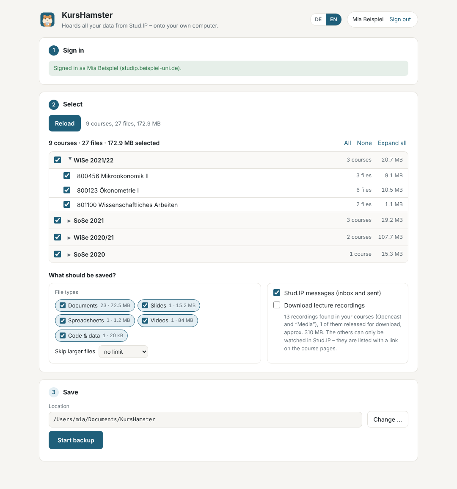

<p align="center"></p>

<h1 align="center">KursHamster</h1>

<p align="center">Saves everything from Stud.IP to your own computer.<br>
<a href="README.md">Deutsche Version</a></p>

KursHamster downloads the files from all your Stud.IP courses, sorted by semester and course. It also saves your Stud.IP messages and creates a small info page for each course with teachers, dates and description.

This is especially useful when you finish your studies. Some time after you leave university, your account is deleted, and with it your access to Stud.IP.

<p align="center"></p>

## Download

- **Windows:** [KursHamster-Windows-Setup.exe](https://github.com/john-bruene/kurshamster/releases/latest/download/KursHamster-Windows-Setup.exe)
- **Mac** (Apple silicon and Intel): [KursHamster-Mac.dmg](https://github.com/john-bruene/kurshamster/releases/latest/download/KursHamster-Mac.dmg)

The app is free and can be switched between English and German at the top right. The Windows version is going to be signed through the SignPath Foundation, see [code signing policy](#code-signing-policy).

## Install

**Windows:** Open `KursHamster-Windows-Setup.exe`. If you see “Windows protected your PC”, click **More info** and then **Run anyway**. Afterwards KursHamster is in your Start menu.

**Mac:** Open `KursHamster-Mac.dmg` and drag the hamster into **Applications**. Open it from there. The first time, macOS says the app could not be verified: click **Done**, open **System Settings → Privacy & Security**, scroll down and click **Open Anyway** next to KursHamster.

These warnings appear because KursHamster does not have a paid developer certificate from Apple or Microsoft yet. They say nothing about whether the app is safe. The source code is public here.

## How it works

1. Choose your university and click **Sign in with Stud.IP**. Your university's normal sign-in page opens.
2. KursHamster reads your courses, which takes about half a minute. You can deselect semesters or courses and exclude, for example, videos.
3. Pick a folder and click **Start backup**. When it is done, **Open overview** shows your archive in the browser.

You can cancel at any time. Next time, KursHamster only downloads what is missing or has changed in Stud.IP.

## Is it safe?

You only enter your password on your university's sign-in page. KursHamster never sees or stores it. The app only connects to your university's Stud.IP, and at start it asks GitHub whether there is a new version (you can switch that off at the bottom of the app). There is no KursHamster server and no data about you is collected.

KursHamster is a private project and not affiliated with your university or the makers of Stud.IP.

## Questions

**Lecture recordings?** Videos that Stud.IP offers for download can be saved too (off by default, they get large). Many recordings, especially in the “Media” tab, can only be watched in Stud.IP. KursHamster does not download those; they are listed with a link on the course page.

**May I share the files?** No. Slides, scripts and videos are protected by copyright. Keep them for yourself.

**My university is not in the list.** Choose **Other university …** in the app and enter the address you normally use for Stud.IP. That works for most Stud.IP universities.

**Something does not work.** [Tell us what happened.](https://github.com/john-bruene/kurshamster/issues/new?template=problem.yml) You need a free GitHub account for that.

## Supported universities

<!-- unis:start -->
You can pick these 28 universities directly in KursHamster. Other universities with Stud.IP usually work too: choose **Other university …** in the app and enter the Stud.IP address.

```geojson
{"type":"FeatureCollection","features":[{"type":"Feature","properties":{"name":"Universität Augsburg","Stud.IP":"digicampus.uni-augsburg.de","marker-color":"#1f5f7a","marker-symbol":"college"},"geometry":{"type":"Point","coordinates":[10.8975,48.3334]}},{"type":"Feature","properties":{"name":"Technische Universität Braunschweig","Stud.IP":"studip.tu-braunschweig.de","marker-color":"#1f5f7a","marker-symbol":"college"},"geometry":{"type":"Point","coordinates":[10.5297,52.2735]}},{"type":"Feature","properties":{"name":"Universität Bremen","Stud.IP":"elearning.uni-bremen.de","marker-color":"#1f5f7a","marker-symbol":"college"},"geometry":{"type":"Point","coordinates":[8.8522,53.1069]}},{"type":"Feature","properties":{"name":"Technische Universität Clausthal","Stud.IP":"studip.tu-clausthal.de","marker-color":"#1f5f7a","marker-symbol":"college"},"geometry":{"type":"Point","coordinates":[10.3349,51.8049]}},{"type":"Feature","properties":{"name":"Evangelische Hochschule Dresden","Stud.IP":"studip.ehs-dresden.de","marker-color":"#1f5f7a","marker-symbol":"college"},"geometry":{"type":"Point","coordinates":[13.7565,51.0458]}},{"type":"Feature","properties":{"name":"Hochschule Flensburg","Stud.IP":"elearning.fh-flensburg.de/studip","marker-color":"#1f5f7a","marker-symbol":"college"},"geometry":{"type":"Point","coordinates":[9.451,54.7745]}},{"type":"Feature","properties":{"name":"Katholische Hochschule Freiburg","Stud.IP":"studip.kh-freiburg.de","marker-color":"#1f5f7a","marker-symbol":"college"},"geometry":{"type":"Point","coordinates":[7.841,47.9985]}},{"type":"Feature","properties":{"name":"Hochschule Geisenheim","Stud.IP":"studip.hs-gm.de","marker-color":"#1f5f7a","marker-symbol":"college"},"geometry":{"type":"Point","coordinates":[7.958,49.9858]}},{"type":"Feature","properties":{"name":"Justus-Liebig-Universität Gießen","Stud.IP":"studip.uni-giessen.de","marker-color":"#1f5f7a","marker-symbol":"college"},"geometry":{"type":"Point","coordinates":[8.677,50.58]}},{"type":"Feature","properties":{"name":"Georg-August-Universität Göttingen","Stud.IP":"studip.uni-goettingen.de","marker-color":"#1f5f7a","marker-symbol":"college"},"geometry":{"type":"Point","coordinates":[9.9358,51.5413]}},{"type":"Feature","properties":{"name":"Martin-Luther-Universität Halle-Wittenberg","Stud.IP":"studip.uni-halle.de","marker-color":"#1f5f7a","marker-symbol":"college"},"geometry":{"type":"Point","coordinates":[11.969,51.486]}},{"type":"Feature","properties":{"name":"Technische Universität Hamburg","Stud.IP":"e-learning.tuhh.de/studip","marker-color":"#1f5f7a","marker-symbol":"college"},"geometry":{"type":"Point","coordinates":[9.969,53.46]}},{"type":"Feature","properties":{"name":"Leibniz Universität Hannover","Stud.IP":"studip.uni-hannover.de","marker-color":"#1f5f7a","marker-symbol":"college"},"geometry":{"type":"Point","coordinates":[9.7176,52.3822]}},{"type":"Feature","properties":{"name":"Pädagogische Hochschule Heidelberg","Stud.IP":"studip.ph-heidelberg.de","marker-color":"#1f5f7a","marker-symbol":"college"},"geometry":{"type":"Point","coordinates":[8.68,49.413]}},{"type":"Feature","properties":{"name":"HAWK Hildesheim/Holzminden/Göttingen","Stud.IP":"studip.hawk.de","marker-color":"#1f5f7a","marker-symbol":"college"},"geometry":{"type":"Point","coordinates":[9.965,52.143]}},{"type":"Feature","properties":{"name":"Hochschule für Wirtschaft und Umwelt Nürtingen-Geislingen","Stud.IP":"neo.hfwu.de","marker-color":"#1f5f7a","marker-symbol":"college"},"geometry":{"type":"Point","coordinates":[9.3432,48.6264]}},{"type":"Feature","properties":{"name":"Carl von Ossietzky Universität Oldenburg","Stud.IP":"elearning.uni-oldenburg.de","marker-color":"#1f5f7a","marker-symbol":"college"},"geometry":{"type":"Point","coordinates":[8.181,53.1474]}},{"type":"Feature","properties":{"name":"Universität Osnabrück","Stud.IP":"studip.uni-osnabrueck.de","marker-color":"#1f5f7a","marker-symbol":"college"},"geometry":{"type":"Point","coordinates":[8.0444,52.2716]}},{"type":"Feature","properties":{"name":"Universität Passau","Stud.IP":"studip.uni-passau.de/studip","marker-color":"#1f5f7a","marker-symbol":"college"},"geometry":{"type":"Point","coordinates":[13.451,48.567]}},{"type":"Feature","properties":{"name":"Hochschule RheinMain","Stud.IP":"studip.hs-rm.de","marker-color":"#1f5f7a","marker-symbol":"college"},"geometry":{"type":"Point","coordinates":[8.217,50.096]}},{"type":"Feature","properties":{"name":"Universität Rostock","Stud.IP":"studip.uni-rostock.de","marker-color":"#1f5f7a","marker-symbol":"college"},"geometry":{"type":"Point","coordinates":[12.1405,54.0887]}},{"type":"Feature","properties":{"name":"Hochschule Schmalkalden","Stud.IP":"studip.hs-schmalkalden.de","marker-color":"#1f5f7a","marker-symbol":"college"},"geometry":{"type":"Point","coordinates":[10.456,50.723]}},{"type":"Feature","properties":{"name":"Pädagogische Hochschule Schwäbisch Gmünd","Stud.IP":"lms.ph-gmuend.de","marker-color":"#1f5f7a","marker-symbol":"college"},"geometry":{"type":"Point","coordinates":[9.816,48.798]}},{"type":"Feature","properties":{"name":"Hochschule Trier","Stud.IP":"studip.hochschule-trier.de","marker-color":"#1f5f7a","marker-symbol":"college"},"geometry":{"type":"Point","coordinates":[6.651,49.753]}},{"type":"Feature","properties":{"name":"Universität Trier","Stud.IP":"studip.uni-trier.de","marker-color":"#1f5f7a","marker-symbol":"college"},"geometry":{"type":"Point","coordinates":[6.688,49.746]}},{"type":"Feature","properties":{"name":"Universität Vechta","Stud.IP":"www.studip.uni-vechta.de","marker-color":"#1f5f7a","marker-symbol":"college"},"geometry":{"type":"Point","coordinates":[8.287,52.726]}},{"type":"Feature","properties":{"name":"Hochschule Wismar","Stud.IP":"studip.hs-wismar.de","marker-color":"#1f5f7a","marker-symbol":"college"},"geometry":{"type":"Point","coordinates":[11.456,53.892]}},{"type":"Feature","properties":{"name":"Ostfalia Hochschule für angewandte Wissenschaften","Stud.IP":"studip.ostfalia.de","marker-color":"#1f5f7a","marker-symbol":"college"},"geometry":{"type":"Point","coordinates":[10.547,52.165]}}]}
```

<details>
<summary>All universities as a list</summary>

| University | City | Stud.IP |
|---|---|---|
| Universität Augsburg | Augsburg | [digicampus.uni-augsburg.de](https://digicampus.uni-augsburg.de) |
| Technische Universität Braunschweig | Braunschweig | [studip.tu-braunschweig.de](https://studip.tu-braunschweig.de) |
| Universität Bremen | Bremen | [elearning.uni-bremen.de](https://elearning.uni-bremen.de) |
| Technische Universität Clausthal | Clausthal-Zellerfeld | [studip.tu-clausthal.de](https://studip.tu-clausthal.de) |
| Evangelische Hochschule Dresden | Dresden | [studip.ehs-dresden.de](https://studip.ehs-dresden.de) |
| Hochschule Flensburg | Flensburg | [elearning.fh-flensburg.de/studip](https://elearning.fh-flensburg.de/studip) |
| Katholische Hochschule Freiburg | Freiburg im Breisgau | [studip.kh-freiburg.de](https://studip.kh-freiburg.de) |
| Hochschule Geisenheim | Geisenheim | [studip.hs-gm.de](https://studip.hs-gm.de) |
| Justus-Liebig-Universität Gießen | Gießen | [studip.uni-giessen.de](https://studip.uni-giessen.de) |
| Georg-August-Universität Göttingen | Göttingen | [studip.uni-goettingen.de](https://studip.uni-goettingen.de) |
| Martin-Luther-Universität Halle-Wittenberg | Halle (Saale) | [studip.uni-halle.de](https://studip.uni-halle.de) |
| Technische Universität Hamburg | Hamburg | [e-learning.tuhh.de/studip](https://e-learning.tuhh.de/studip) |
| Leibniz Universität Hannover | Hannover | [studip.uni-hannover.de](https://studip.uni-hannover.de) |
| Pädagogische Hochschule Heidelberg | Heidelberg | [studip.ph-heidelberg.de](https://studip.ph-heidelberg.de) |
| HAWK Hildesheim/Holzminden/Göttingen | Hildesheim | [studip.hawk.de](https://studip.hawk.de) |
| Hochschule für Wirtschaft und Umwelt Nürtingen-Geislingen | Nürtingen | [neo.hfwu.de](https://neo.hfwu.de) |
| Carl von Ossietzky Universität Oldenburg | Oldenburg | [elearning.uni-oldenburg.de](https://elearning.uni-oldenburg.de) |
| Universität Osnabrück | Osnabrück | [studip.uni-osnabrueck.de](https://studip.uni-osnabrueck.de) |
| Universität Passau | Passau | [studip.uni-passau.de/studip](https://studip.uni-passau.de/studip) |
| Universität Rostock | Rostock | [studip.uni-rostock.de](https://studip.uni-rostock.de) |
| Hochschule Schmalkalden | Schmalkalden | [studip.hs-schmalkalden.de](https://studip.hs-schmalkalden.de) |
| Pädagogische Hochschule Schwäbisch Gmünd | Schwäbisch Gmünd | [lms.ph-gmuend.de](https://lms.ph-gmuend.de) |
| Hochschule Trier | Trier | [studip.hochschule-trier.de](https://studip.hochschule-trier.de) |
| Universität Trier | Trier | [studip.uni-trier.de](https://studip.uni-trier.de) |
| Universität Vechta | Vechta | [www.studip.uni-vechta.de](https://www.studip.uni-vechta.de) |
| Hochschule RheinMain | Wiesbaden | [studip.hs-rm.de](https://studip.hs-rm.de) |
| Hochschule Wismar | Wismar | [studip.hs-wismar.de](https://studip.hs-wismar.de) |
| Ostfalia Hochschule für angewandte Wissenschaften | Wolfenbüttel | [studip.ostfalia.de](https://studip.ostfalia.de) |

</details>
<!-- unis:end -->

## Code signing policy

Free code signing provided by [SignPath.io](https://signpath.io), certificate by [SignPath Foundation](https://signpath.org). The application has been submitted. Until it is confirmed, the Windows installers are not signed yet.

Only installers that GitHub Actions builds directly from the source code in this repository are signed. Every signed release is approved manually.

| Role | Who |
|---|---|
| Author (code changes) | [John Frederic Brüne](https://github.com/john-bruene) |
| Reviewer of contributions | [John Frederic Brüne](https://github.com/john-bruene) |
| Approver of signing requests | [John Frederic Brüne](https://github.com/john-bruene) |

**Privacy:** KursHamster does not transfer any information to other networked systems, except to the Stud.IP of the university you sign in to, and to GitHub to check for a new version at start. That check can be switched off at the bottom of the app.

## For developers

See [CONTRIBUTING.md](CONTRIBUTING.md) (in German). KursHamster is licensed under the [MIT License](LICENSE).
