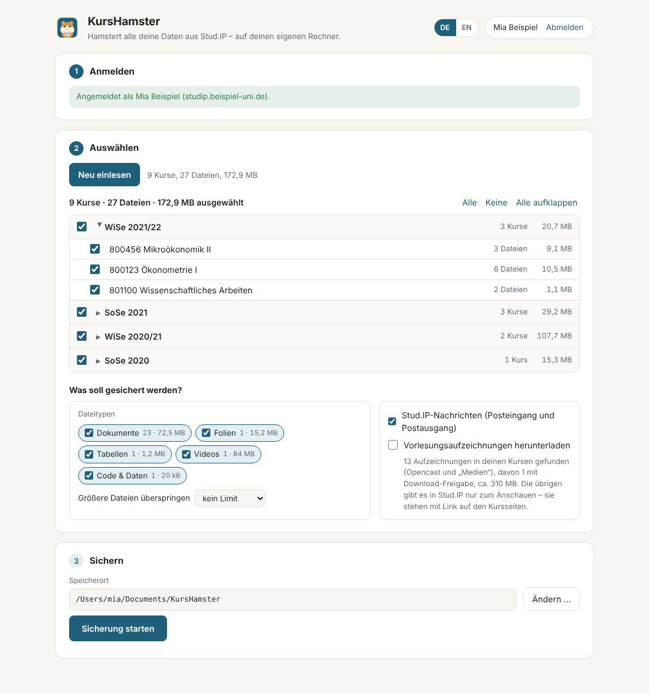
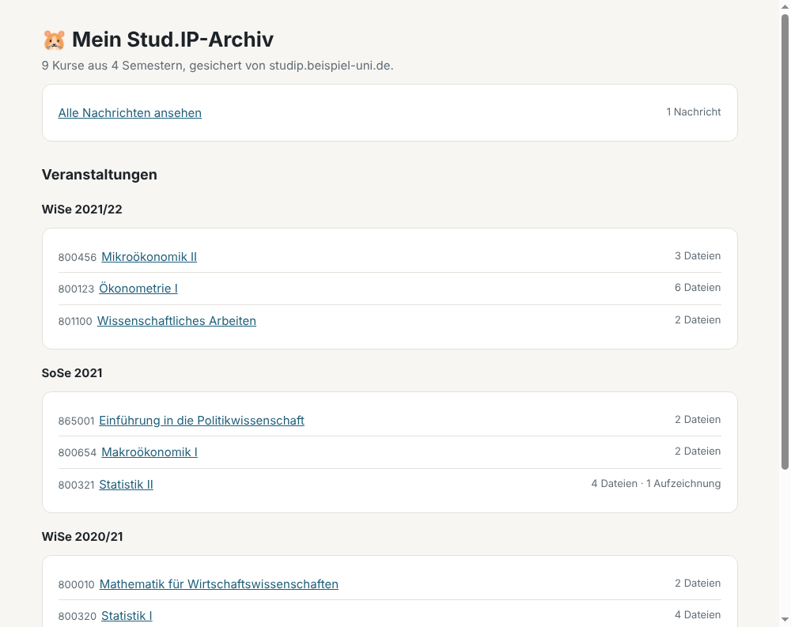
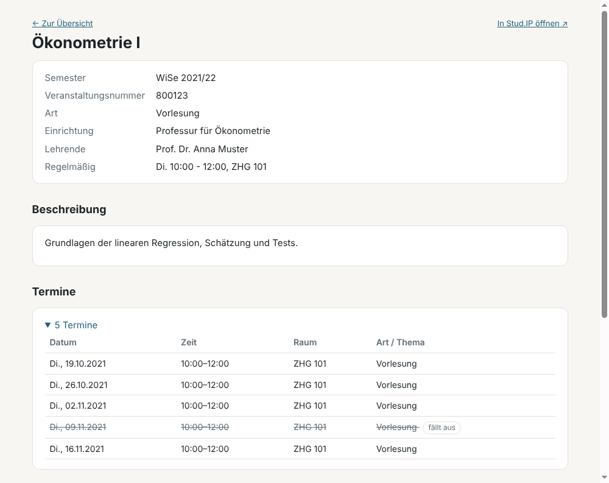

<p align="center"></p>

<h1 align="center">KursHamster</h1>

<p align="center">Speichert alles aus Stud.IP auf deinem eigenen Computer.<br>
<a href="README.en.md">English version</a></p>

KursHamster lädt die Dateien aus all deinen Stud.IP-Veranstaltungen herunter, sortiert nach Semester und Kurs. Dazu kommen deine Stud.IP-Nachrichten und für jeden Kurs eine kleine Infoseite mit Lehrenden, Terminen und Beschreibung.

Das ist vor allem am Ende des Studiums praktisch. Nach der Exmatrikulation wird dein Uni-Account irgendwann gelöscht, und damit auch dein Zugang zu Stud.IP.

<p align="center"></p>

## Herunterladen

- **Windows:** [KursHamster-Windows-Setup.exe](https://github.com/john-bruene/kurshamster/releases/latest/download/KursHamster-Windows-Setup.exe)
- **Mac** (Apple-Chip und Intel): [KursHamster-Mac.dmg](https://github.com/john-bruene/kurshamster/releases/latest/download/KursHamster-Mac.dmg)

Die App ist kostenlos. Ältere Versionen und Hinweise zu Änderungen stehen auf der [Versionsseite](https://github.com/john-bruene/kurshamster/releases).

## Installieren

### Windows

1. Lade `KursHamster-Windows-Setup.exe` herunter und öffne die Datei.
2. Vermutlich erscheint „Der Computer wurde durch Windows geschützt“. Klick auf **Weitere Informationen** und dann auf **Trotzdem ausführen**.
3. Folge dem Installationsprogramm. Danach findest du KursHamster im Startmenü.

### Mac

1. Lade `KursHamster-Mac.dmg` herunter und öffne die Datei.
2. Zieh den Hamster in den Ordner **Programme**.
3. Öffne KursHamster aus dem Ordner Programme. Beim ersten Mal meldet macOS, dass die App nicht überprüft werden konnte. Klick auf **Fertig**, öffne dann **Systemeinstellungen → Datenschutz & Sicherheit**, scroll ganz nach unten und klick bei KursHamster auf **Dennoch öffnen**.

Die Warnungen kommen, weil KursHamster noch kein kostenpflichtiges Entwicklerzertifikat von Apple bzw. Microsoft hat. Sie sagen nichts darüber aus, ob die App sicher ist. Der Quellcode ist hier öffentlich einsehbar.

## So geht's

1. Wähl deine Hochschule aus und klick auf **Mit Stud.IP anmelden**. Es öffnet sich die ganz normale Anmeldeseite deiner Uni.
2. KursHamster liest jetzt deine Kurse ein. Das dauert etwa eine halbe Minute. Du kannst einzelne Semester oder Kurse abwählen und zum Beispiel Videos ausschließen.
3. Such dir einen Speicherort aus und klick auf **Sicherung starten**. Am Ende öffnet **Übersicht öffnen** dein Archiv im Browser.

Du kannst jederzeit abbrechen. Beim nächsten Start lädt KursHamster nur, was noch fehlt oder sich in Stud.IP geändert hat.

## Was du am Ende hast

Einen Ordner mit einem Unterordner pro Semester und darin einen pro Kurs, mit denselben Ordnern und Dateien wie in Stud.IP. Ganz oben liegt `_Übersicht.html`. Ein Doppelklick öffnet sie im Browser, und von dort kommst du zu jedem Kurs. Das funktioniert auch ohne Internet und noch Jahre später.

<table>
<tr>
<td width="50%"></td>
<td width="50%"></td>
</tr>
<tr>
<td>Die Übersicht mit allen Kursen</td>
<td>Die Infoseite zu einem Kurs</td>
</tr>
</table>

Außerdem gesichert werden deine Stud.IP-Nachrichten (Posteingang und Postausgang), auf Wunsch auch Vorlesungsaufzeichnungen (siehe unten). Ordner, die nur Lehrende sehen dürfen, zum Beispiel Abgabeordner, kann KursHamster nicht laden. Sie stehen in der Datei `_fehler.txt`.

## Ist das sicher?

Dein Passwort gibst du nur auf der Anmeldeseite deiner Hochschule ein. KursHamster bekommt es nie zu sehen und speichert es nicht.

Die App verbindet sich nur mit dem Stud.IP deiner Hochschule. Zusätzlich fragt sie beim Start bei GitHub nach, ob es eine neue Version gibt. Das kannst du unten in der App abschalten. Es gibt keinen KursHamster-Server, und es werden keine Daten über dich gesammelt.

KursHamster ist ein privates Projekt und gehört weder zu deiner Hochschule noch zu den Entwicklern von Stud.IP.

## Häufige Fragen

**Was ist mit Vorlesungsvideos?**
Videos, die Stud.IP zum Herunterladen anbietet, kann KursHamster mitsichern. Das ist standardmäßig ausgeschaltet, weil es schnell sehr viele Gigabyte werden. Viele Aufzeichnungen, besonders im Reiter „Medien“, lassen sich in Stud.IP aber nur ansehen und nicht herunterladen. Die lädt KursHamster nicht. Sie stehen mit Titel, Datum und Link auf der jeweiligen Kursseite, und der Link funktioniert, solange dein Account besteht.

**Wie lange dauert die Sicherung?**
Das hängt davon ab, wie viel du hast und wie schnell der Uni-Server gerade ist. Ein paar Gigabyte dauern eine Weile. Du kannst den Computer währenddessen normal benutzen. Von selbst geht er dabei nicht in den Ruhezustand, nur Zuklappen solltest du ihn nicht.

**Mein Uni-Account ist schon gelöscht.**
Dann geht es leider nicht mehr. KursHamster nutzt deinen normalen Zugang zu Stud.IP.

**Darf ich die Dateien weitergeben?**
Nein. Folien, Skripte und Videos sind urheberrechtlich geschützt. Behalte sie für dich.

**Meine Hochschule ist nicht in der Liste.**
Wähl in der App **Andere Hochschule …** und gib die Adresse ein, unter der du Stud.IP sonst im Browser öffnest. Das klappt bei den meisten Hochschulen mit Stud.IP. Wenn es funktioniert, [sag gern Bescheid](https://github.com/john-bruene/kurshamster/issues/new?template=hochschule.yml), dann kommt deine Hochschule in die Liste.

**Es funktioniert etwas nicht.**
[Beschreib hier, was passiert ist.](https://github.com/john-bruene/kurshamster/issues/new?template=problem.yml) Dafür brauchst du ein kostenloses GitHub-Konto. Hilfreich sind deine Hochschule, dein Betriebssystem und, falls vorhanden, der Inhalt von `_fehler.txt`.

## Unterstützte Hochschulen

<!-- unis:start -->
Diese 28 Hochschulen kannst du in KursHamster direkt auswählen. Andere Hochschulen mit Stud.IP funktionieren meistens auch: Wähl in der App **Andere Hochschule …** und gib die Stud.IP-Adresse ein.

```geojson
{"type":"FeatureCollection","features":[{"type":"Feature","properties":{"name":"Universität Augsburg","Stud.IP":"digicampus.uni-augsburg.de","marker-color":"#1f5f7a","marker-symbol":"college"},"geometry":{"type":"Point","coordinates":[10.8975,48.3334]}},{"type":"Feature","properties":{"name":"Technische Universität Braunschweig","Stud.IP":"studip.tu-braunschweig.de","marker-color":"#1f5f7a","marker-symbol":"college"},"geometry":{"type":"Point","coordinates":[10.5297,52.2735]}},{"type":"Feature","properties":{"name":"Universität Bremen","Stud.IP":"elearning.uni-bremen.de","marker-color":"#1f5f7a","marker-symbol":"college"},"geometry":{"type":"Point","coordinates":[8.8522,53.1069]}},{"type":"Feature","properties":{"name":"Technische Universität Clausthal","Stud.IP":"studip.tu-clausthal.de","marker-color":"#1f5f7a","marker-symbol":"college"},"geometry":{"type":"Point","coordinates":[10.3349,51.8049]}},{"type":"Feature","properties":{"name":"Evangelische Hochschule Dresden","Stud.IP":"studip.ehs-dresden.de","marker-color":"#1f5f7a","marker-symbol":"college"},"geometry":{"type":"Point","coordinates":[13.7565,51.0458]}},{"type":"Feature","properties":{"name":"Hochschule Flensburg","Stud.IP":"elearning.fh-flensburg.de/studip","marker-color":"#1f5f7a","marker-symbol":"college"},"geometry":{"type":"Point","coordinates":[9.451,54.7745]}},{"type":"Feature","properties":{"name":"Katholische Hochschule Freiburg","Stud.IP":"studip.kh-freiburg.de","marker-color":"#1f5f7a","marker-symbol":"college"},"geometry":{"type":"Point","coordinates":[7.841,47.9985]}},{"type":"Feature","properties":{"name":"Hochschule Geisenheim","Stud.IP":"studip.hs-gm.de","marker-color":"#1f5f7a","marker-symbol":"college"},"geometry":{"type":"Point","coordinates":[7.958,49.9858]}},{"type":"Feature","properties":{"name":"Justus-Liebig-Universität Gießen","Stud.IP":"studip.uni-giessen.de","marker-color":"#1f5f7a","marker-symbol":"college"},"geometry":{"type":"Point","coordinates":[8.677,50.58]}},{"type":"Feature","properties":{"name":"Georg-August-Universität Göttingen","Stud.IP":"studip.uni-goettingen.de","marker-color":"#1f5f7a","marker-symbol":"college"},"geometry":{"type":"Point","coordinates":[9.9358,51.5413]}},{"type":"Feature","properties":{"name":"Martin-Luther-Universität Halle-Wittenberg","Stud.IP":"studip.uni-halle.de","marker-color":"#1f5f7a","marker-symbol":"college"},"geometry":{"type":"Point","coordinates":[11.969,51.486]}},{"type":"Feature","properties":{"name":"Technische Universität Hamburg","Stud.IP":"e-learning.tuhh.de/studip","marker-color":"#1f5f7a","marker-symbol":"college"},"geometry":{"type":"Point","coordinates":[9.969,53.46]}},{"type":"Feature","properties":{"name":"Leibniz Universität Hannover","Stud.IP":"studip.uni-hannover.de","marker-color":"#1f5f7a","marker-symbol":"college"},"geometry":{"type":"Point","coordinates":[9.7176,52.3822]}},{"type":"Feature","properties":{"name":"Pädagogische Hochschule Heidelberg","Stud.IP":"studip.ph-heidelberg.de","marker-color":"#1f5f7a","marker-symbol":"college"},"geometry":{"type":"Point","coordinates":[8.68,49.413]}},{"type":"Feature","properties":{"name":"HAWK Hildesheim/Holzminden/Göttingen","Stud.IP":"studip.hawk.de","marker-color":"#1f5f7a","marker-symbol":"college"},"geometry":{"type":"Point","coordinates":[9.965,52.143]}},{"type":"Feature","properties":{"name":"Hochschule für Wirtschaft und Umwelt Nürtingen-Geislingen","Stud.IP":"neo.hfwu.de","marker-color":"#1f5f7a","marker-symbol":"college"},"geometry":{"type":"Point","coordinates":[9.3432,48.6264]}},{"type":"Feature","properties":{"name":"Carl von Ossietzky Universität Oldenburg","Stud.IP":"elearning.uni-oldenburg.de","marker-color":"#1f5f7a","marker-symbol":"college"},"geometry":{"type":"Point","coordinates":[8.181,53.1474]}},{"type":"Feature","properties":{"name":"Universität Osnabrück","Stud.IP":"studip.uni-osnabrueck.de","marker-color":"#1f5f7a","marker-symbol":"college"},"geometry":{"type":"Point","coordinates":[8.0444,52.2716]}},{"type":"Feature","properties":{"name":"Universität Passau","Stud.IP":"studip.uni-passau.de/studip","marker-color":"#1f5f7a","marker-symbol":"college"},"geometry":{"type":"Point","coordinates":[13.451,48.567]}},{"type":"Feature","properties":{"name":"Hochschule RheinMain","Stud.IP":"studip.hs-rm.de","marker-color":"#1f5f7a","marker-symbol":"college"},"geometry":{"type":"Point","coordinates":[8.217,50.096]}},{"type":"Feature","properties":{"name":"Universität Rostock","Stud.IP":"studip.uni-rostock.de","marker-color":"#1f5f7a","marker-symbol":"college"},"geometry":{"type":"Point","coordinates":[12.1405,54.0887]}},{"type":"Feature","properties":{"name":"Hochschule Schmalkalden","Stud.IP":"studip.hs-schmalkalden.de","marker-color":"#1f5f7a","marker-symbol":"college"},"geometry":{"type":"Point","coordinates":[10.456,50.723]}},{"type":"Feature","properties":{"name":"Pädagogische Hochschule Schwäbisch Gmünd","Stud.IP":"lms.ph-gmuend.de","marker-color":"#1f5f7a","marker-symbol":"college"},"geometry":{"type":"Point","coordinates":[9.816,48.798]}},{"type":"Feature","properties":{"name":"Hochschule Trier","Stud.IP":"studip.hochschule-trier.de","marker-color":"#1f5f7a","marker-symbol":"college"},"geometry":{"type":"Point","coordinates":[6.651,49.753]}},{"type":"Feature","properties":{"name":"Universität Trier","Stud.IP":"studip.uni-trier.de","marker-color":"#1f5f7a","marker-symbol":"college"},"geometry":{"type":"Point","coordinates":[6.688,49.746]}},{"type":"Feature","properties":{"name":"Universität Vechta","Stud.IP":"www.studip.uni-vechta.de","marker-color":"#1f5f7a","marker-symbol":"college"},"geometry":{"type":"Point","coordinates":[8.287,52.726]}},{"type":"Feature","properties":{"name":"Hochschule Wismar","Stud.IP":"studip.hs-wismar.de","marker-color":"#1f5f7a","marker-symbol":"college"},"geometry":{"type":"Point","coordinates":[11.456,53.892]}},{"type":"Feature","properties":{"name":"Ostfalia Hochschule für angewandte Wissenschaften","Stud.IP":"studip.ostfalia.de","marker-color":"#1f5f7a","marker-symbol":"college"},"geometry":{"type":"Point","coordinates":[10.547,52.165]}}]}
```

<details>
<summary>Alle Hochschulen als Liste</summary>

| Hochschule | Ort | Stud.IP |
|---|---|---|
| Universität Augsburg | Augsburg | [digicampus.uni-augsburg.de](https://digicampus.uni-augsburg.de) |
| Technische Universität Braunschweig | Braunschweig | [studip.tu-braunschweig.de](https://studip.tu-braunschweig.de) |
| Universität Bremen | Bremen | [elearning.uni-bremen.de](https://elearning.uni-bremen.de) |
| Technische Universität Clausthal | Clausthal-Zellerfeld | [studip.tu-clausthal.de](https://studip.tu-clausthal.de) |
| Evangelische Hochschule Dresden | Dresden | [studip.ehs-dresden.de](https://studip.ehs-dresden.de) |
| Hochschule Flensburg | Flensburg | [elearning.fh-flensburg.de/studip](https://elearning.fh-flensburg.de/studip) |
| Katholische Hochschule Freiburg | Freiburg im Breisgau | [studip.kh-freiburg.de](https://studip.kh-freiburg.de) |
| Hochschule Geisenheim | Geisenheim | [studip.hs-gm.de](https://studip.hs-gm.de) |
| Justus-Liebig-Universität Gießen | Gießen | [studip.uni-giessen.de](https://studip.uni-giessen.de) |
| Georg-August-Universität Göttingen | Göttingen | [studip.uni-goettingen.de](https://studip.uni-goettingen.de) |
| Martin-Luther-Universität Halle-Wittenberg | Halle (Saale) | [studip.uni-halle.de](https://studip.uni-halle.de) |
| Technische Universität Hamburg | Hamburg | [e-learning.tuhh.de/studip](https://e-learning.tuhh.de/studip) |
| Leibniz Universität Hannover | Hannover | [studip.uni-hannover.de](https://studip.uni-hannover.de) |
| Pädagogische Hochschule Heidelberg | Heidelberg | [studip.ph-heidelberg.de](https://studip.ph-heidelberg.de) |
| HAWK Hildesheim/Holzminden/Göttingen | Hildesheim | [studip.hawk.de](https://studip.hawk.de) |
| Hochschule für Wirtschaft und Umwelt Nürtingen-Geislingen | Nürtingen | [neo.hfwu.de](https://neo.hfwu.de) |
| Carl von Ossietzky Universität Oldenburg | Oldenburg | [elearning.uni-oldenburg.de](https://elearning.uni-oldenburg.de) |
| Universität Osnabrück | Osnabrück | [studip.uni-osnabrueck.de](https://studip.uni-osnabrueck.de) |
| Universität Passau | Passau | [studip.uni-passau.de/studip](https://studip.uni-passau.de/studip) |
| Universität Rostock | Rostock | [studip.uni-rostock.de](https://studip.uni-rostock.de) |
| Hochschule Schmalkalden | Schmalkalden | [studip.hs-schmalkalden.de](https://studip.hs-schmalkalden.de) |
| Pädagogische Hochschule Schwäbisch Gmünd | Schwäbisch Gmünd | [lms.ph-gmuend.de](https://lms.ph-gmuend.de) |
| Hochschule Trier | Trier | [studip.hochschule-trier.de](https://studip.hochschule-trier.de) |
| Universität Trier | Trier | [studip.uni-trier.de](https://studip.uni-trier.de) |
| Universität Vechta | Vechta | [www.studip.uni-vechta.de](https://www.studip.uni-vechta.de) |
| Hochschule RheinMain | Wiesbaden | [studip.hs-rm.de](https://studip.hs-rm.de) |
| Hochschule Wismar | Wismar | [studip.hs-wismar.de](https://studip.hs-wismar.de) |
| Ostfalia Hochschule für angewandte Wissenschaften | Wolfenbüttel | [studip.ostfalia.de](https://studip.ostfalia.de) |

</details>
<!-- unis:end -->

## Für Entwicklerinnen und Entwickler

Wie die App aufgebaut ist und wie man sie selbst baut, steht in [CONTRIBUTING.md](CONTRIBUTING.md). KursHamster steht unter der [MIT-Lizenz](LICENSE).
